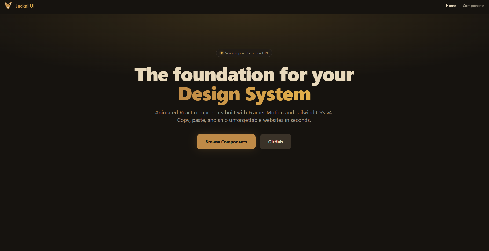

# Jackal UI 🐺

Jackal UI is a collection of reusable, beautifully animated React components.

**This is not a traditional library you install via npm.** Instead, you copy and paste the components you need directly into your project. This gives you full ownership, control, and customizability over the code!

# Interface



## Guida all'Uso (How to Use)

Per permettere a qualsiasi componente di funzionare subito e senza errori nel tuo progetto, assicurati di seguire questi semplici passaggi. **Non devi installare o clonare l'intero programma**, ma solo preparare il tuo ambiente per supportare i componenti.

### 1. Requisiti di Base

Assicurati che il tuo progetto utilizzi:

- **React** (v18+)
- **Tailwind CSS** (v4 consigliato)

### 2. Installa le dipendenze per le animazioni

Quasi tutti i componenti animati di Jackal UI utilizzano **Framer Motion** per gestire la fisica e la fluidità dei movimenti.
Apri il terminale nel tuo progetto ed esegui:

```bash
npm install framer-motion
```

### 3. Configura i Colori di Tailwind CSS

Tutti i componenti di Jackal UI utilizzano una palette di colori personalizzata. Affinché i componenti abbiano l'aspetto corretto non appena incollati, devi aggiungere le nostre variabili colore al tuo progetto.

**Se usi Tailwind CSS v4:**
Apri il tuo file CSS principale (es. `index.css` o `globals.css`) e aggiungi queste variabili all'interno del blocco `@theme`:

```css
@import "tailwindcss";

@theme {
  --color-night: #16130f;
  --color-den: #211c16;
  --color-earth: #3a3228;
  --color-back: #a39a88;
  --color-fur: #bf8a47;
  --color-amber: #e3b04b;
  --color-sand: #e8d9bc;
  --color-steel: #5c6b73;
}
```

_Nota: Se usi Tailwind CSS v3, aggiungi questi colori all'interno dell'oggetto `theme.extend.colors` nel tuo `tailwind.config.js`._

### 4. Copia e Incolla!

Tutto è pronto. Ora puoi navigare tra i componenti di Jackal UI, cliccare su "Show Code", e **copiare e incollare il codice del componente direttamente nel tuo progetto**.

Ogni componente è progettato per essere indipendente (non importa o dipende da altri file interni di Jackal UI). Funzionerà subito, "out of the box"!

---

### Esempio Rapido:

Se vuoi usare il componente `JackalHowlButton`:

1. Assicurati di aver fatto i passi 1, 2 e 3 qui sopra.
2. Crea un file `JackalHowlButton.jsx` nel tuo progetto.
3. Incolla il codice del componente.
4. Importalo dove vuoi usarlo: `import JackalHowlButton from './JackalHowlButton';` e usalo!
